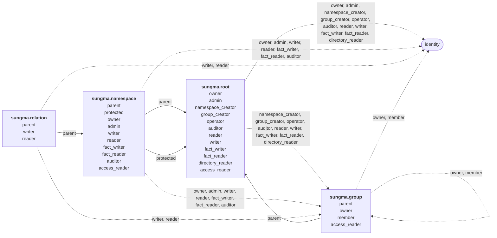

# Sungma's own authorization

Sungma authorizes the callers of its own services with its own model. Who may create a [[namespace]], edit one, or write and read the [[fact]]s under a [[relation]] is itself a set of facts, checked like any other. Author, Sungma's UI, shows each person only what those facts allow.

## Guards

Each endpoint decides for itself whether a request goes through. It's a policy enforcement point (PEP): the place in code that asks the question and acts on the answer. Its guard is hard-coded in the endpoint: a relation, and a [[resource]] built from the route's values. The subject is the caller. In code a guard reads `.Check("owner", "sungma.group:{G}")`, so the endpoint asks `check(sungma.group:{G}#owner, sub)`.

Sungma's Check decides. The model is the policy: namespaces with their relations and [[rewrite]]s, plus facts. A namespace never says who may write or read a relation. Endpoints say that, each with its guard, and the model decides who passes. So adding a relation is a model change, never a code change, and no code holds a list of protected facts or relations.

## Subjects

A [[subject]] holds a relation on a resource when it's in that subjectset's [[closure]]. A subject here is a person's or client's [[identity]], or a group's members. The caller of a request is its token's `sub` claim, an identity, as [[check-takes-a-caller-token-and-a-subject-token]] decides. For Check, that is the caller token's `sub`, not the subject the check is about. Sungma doesn't tell people and clients apart.

## Two tiers

The model separates two kinds of work:

- **Writing namespaces** is specialist work. A namespace's rewrites decide which subjects each closure holds, so whoever edits one needs to understand the security it encodes.
- **Writing facts** is everyday work, such as sharing an invoice. Most people only ever write facts, and usually under a few relations.

Neither implies the other. A namespace's writer can't write its facts unless they also hold a relation that writes facts, and a fact writer can't write the namespace.

## The model

The model is written as a [theory document](theory-documents.md) in Sungma schema language. `theory: sungma` names the shared first segment once, so `root` means `sungma.root`, `group#member` means `sungma.group#member`, and so on. Each namespace is stored under its full name.

```c
theory: sungma

// The root, one resource, sungma.root:sungma: relations across the whole deployment
namespace: root
  owner: identity
  admin: identity = this | owner
  namespace_creator: identity, group#member = this | admin
  group_creator: identity, group#member = this | admin
  operator: identity, group#member = this | admin
  auditor: identity, group#member = this | admin
  reader: identity, group#member = this | auditor
  writer: identity, group#member = this | admin
  fact_writer: identity, group#member = this | admin
  fact_reader: identity, group#member = this | fact_writer | auditor
  directory_reader: identity, group#member = this | auditor
  access_reader = auditor

// Each namespace: who owns it, administers it, reads and writes it and its facts, and audits it
namespace: namespace
  parent: root
  protected: root
  owner: identity, group#member = this | (parent, owner) ! (protected, owner)
  admin: identity, group#member
    = this | owner | (parent, admin) ! (protected, admin)
  writer: identity, group#member
    = this | admin | (parent, writer) ! (protected, writer)
  reader: identity, group#member
    = this | writer | fact_reader | auditor | (parent, reader)
  fact_writer: identity, group#member
    = this | admin | (parent, fact_writer) ! (protected, fact_writer)
  fact_reader: identity, group#member
    = this | fact_writer | auditor | (parent, fact_reader)
  auditor: identity, group#member = this | (parent, auditor)
  access_reader = admin | auditor

// Each relation: the closures that write and read its facts
namespace: relation
  parent: namespace
  writer: identity, group#member = this | (parent, fact_writer)
  reader: identity, group#member = this | writer | (parent, fact_reader)

// Each group: the closures of its owners and members
namespace: group
  parent: root
  owner: identity, group#member = this | (parent, admin)
  member: identity, group#member
  access_reader = owner | (parent, auditor)
```

Drawn as a graph, each namespace is a node, and each relation's constraints are its edges. Solid edges are the `parent` and `protected` links that rewrites follow. Dashed edges go to identities, the keys of people and clients named in facts, and to groups, whose members are named through `group#member`.



`access_reader` relations are computed subjectsets. On a resource, the closure is the set of subjects that may read the resource's facts, and the endpoints that list those facts guard with it:

- On `sungma.root`, the auditors. Every admin is an auditor, so admins and owners read the facts on `sungma.root:sungma` too.
- On `sungma.namespace`, the namespace's admins, owners included, its auditors, and the deployment's auditors. It covers the facts on each `sungma.relation:{N}/{R}` too.
- On `sungma.group`, the group's owners and the deployment's auditors.

On a namespace, managing and retiring are separate. A namespace's `owner` is `this | (parent, owner)`: its own owners, such as its creator, and the root's owners. Owners may retire it, drop its relations, and decide its owners. Its `admin` is `this | owner | (parent, admin)`: its own admins, its owners, and the root's admins. Admins write its document and facts, and write and retire the facts under every relation on it but `owner`. So a root admin manages every customer namespace and can't retire one they don't own. In both rewrites, `!` binds tighter than `|`, so `! (protected, …)` subtracts only what arrives from the root, and only on a namespace that `protected` ties to the root. [Protected namespaces](#protected-namespaces) says why.

Facts name four kinds of resource:

- `sungma.root:sungma`, the one deployment. Setup's first fact names it.
- `sungma.namespace:<name>`, one for each namespace, such as `sungma.namespace:billing`.
- `sungma.relation:<namespace>/<relation>`, one for each relation, such as `sungma.relation:billing/approver`. A relation name holds no `/`, so the id reads one way.
- `sungma.group:<name>`, one for each group, such as `sungma.group:billing-ops`.

## Base facts

The namespaces above, the facts below, and the facts callers write through the endpoints are everything a guard's check reads.

Setup writes these facts at install, before the first caller arrives. Here `alice` and `bob` stand for the `sub`s of the first two owners:

```text
sungma.root:sungma#owner@alice
sungma.root:sungma#owner@bob
sungma.namespace:sungma.root#parent@sungma.root:sungma#...
sungma.namespace:sungma.namespace#parent@sungma.root:sungma#...
sungma.namespace:sungma.relation#parent@sungma.root:sungma#...
sungma.namespace:sungma.group#parent@sungma.root:sungma#...
sungma.namespace:sungma.root#protected@sungma.root:sungma#...
sungma.namespace:sungma.namespace#protected@sungma.root:sungma#...
sungma.namespace:sungma.relation#protected@sungma.root:sungma#...
sungma.namespace:sungma.group#protected@sungma.root:sungma#...
```

The `owner` facts make the owners admins, so they hold `auditor` and every other relation on the root. The `parent` facts let auditors read the documents of Sungma's own namespaces. The `protected` facts take the root's owners and admins back out of those namespaces' owners and admins, as [Protected namespaces](#protected-namespaces) says. Setup writes no `parent` fact on any `sungma.relation` resource, so Sungma's own relations have none.

The endpoints that create things write facts of their own, always these and nothing a caller chooses. Here Carol creates `billing`, which declares `approver` and `viewer`:

```text
sungma.namespace:billing#parent@sungma.root:sungma#...
sungma.namespace:billing#owner@carol
sungma.relation:billing/approver#parent@sungma.namespace:billing#...
sungma.relation:billing/viewer#parent@sungma.namespace:billing#...
```

The first makes every root owner an owner of `billing`, every root admin an admin of it, and every root auditor and reader a reader of it. The second makes Carol an owner, and so an admin, of `billing`. The last two let `billing`'s fact writers and fact readers write and read the facts under its relations.

A later version of `billing` that adds `payer` writes that relation's `parent`:

```text
sungma.relation:billing/payer#parent@sungma.namespace:billing#...
```

Carol creating the group `billing-ops` writes its `parent`, which makes every admin an owner of it, and her `owner`:

```text
sungma.group:billing-ops#parent@sungma.root:sungma#...
sungma.group:billing-ops#owner@carol
```

## Endpoints

Every guard runs for the caller, the caller token's `sub`.

### The fact endpoint

The fact endpoint writes and reads facts under customers' relations. It has one fixed guard for each fact, on the relation the fact is under:

| Endpoint | Guard | What it does |
|---|---|---|
| Write facts | `.Check("writer", "sungma.relation:{N}/{R}")` for each fact under `N:r#R` | Adds or retires each fact in a batch. |
| Read a fact by its key, `N:r#R@s` | `.Check("reader", "sungma.relation:{N}/{R}")` | Reads one fact. |
| Read the facts under a subjectset `N:r#R` | `.Check("reader", "sungma.relation:{N}/{R}")` | Reads the facts under one [[subjectset]]. |
| Read the facts of a resource `N:r` | `.Check("reader", "sungma.relation:{N}/{R}")` for each relation `R` | Reads the facts of one resource, holding only the relations whose guard the caller passes. |
| Check whether a subject is in `N:r#R` | `.Check("reader", "sungma.relation:{N}/{R}")` | Answers one check. |
| [[expand]] `N:r#R` | `.Check("reader", "sungma.relation:{N}/{R}")`; see [open question 9](#open) | Shows the subjects in a subjectset's closure. |
| Watch the changelog stream | open; see [open question 10](#open) | Streams changes. |

A batch is refused whole if any fact in it fails its guard.

A fact's subject may name a resource or subjectset in another namespace. Writing the fact runs only its own relation's guard, nothing on the namespace it points into.

The fact endpoint can't write or read Sungma's own facts. That follows from the facts, not from a check in code. The `sungma.relation` resources for Sungma's own relations, such as `sungma.relation:sungma.root/owner` or `sungma.relation:sungma.namespace/parent`, have no `parent` fact, and no `writer` or `reader` fact. No one holds `writer` or `reader` on them, so every caller fails both guards.

### Dedicated endpoints

Sungma's own facts are managed through dedicated endpoints, each with its own hard-coded guard:

| Endpoint | Guard | What it does |
|---|---|---|
| Write or retire a `member` fact on group `G` | `.Check("owner", "sungma.group:{G}")` | Writes or retires a `sungma.group:{G}#member` fact. |
| Write or retire an `owner` fact on group `G` | `.Check("owner", "sungma.group:{G}")` | Writes or retires a `sungma.group:{G}#owner` fact. |
| Create a group | `.Check("group_creator", "sungma.root:sungma")` | Creates the group, as [Groups](#groups) says. |
| Write or retire an `owner` fact on namespace `N` | `.Check("owner", "sungma.namespace:{N}")` | Writes or retires a `sungma.namespace:{N}#owner` fact. |
| Write or retire a fact under one of `sungma.namespace:{N}`'s other relations: `admin`, `writer`, `reader`, `fact_writer`, `fact_reader` or `auditor` | `.Check("admin", "sungma.namespace:{N}")` | Writes or retires that fact on `sungma.namespace:{N}`. Only owners decide owners, so an admin can't make themselves an owner and then retire the namespace. |
| Write or retire a fact under one of `sungma.relation:{N}/{R}`'s relations: `writer` or `reader` | `.Check("admin", "sungma.namespace:{N}")` | Writes or retires that fact on `sungma.relation:{N}/{R}`. |
| Write or retire an `admin` fact on the root | `.Check("owner", "sungma.root:sungma")` | Writes or retires a `sungma.root:sungma#admin` fact. |
| Write or retire a fact under one of `sungma.root:sungma`'s other relations: `namespace_creator`, `group_creator`, `operator`, `auditor`, `reader`, `writer`, `fact_writer`, `fact_reader` or `directory_reader` | `.Check("admin", "sungma.root:sungma")` | Writes or retires that fact on `sungma.root:sungma`. |
| Create namespace `N` | `.Check("namespace_creator", "sungma.root:sungma")` | Creates the namespace, as [Creating a namespace](#creating-a-namespace) says. |
| Write a new version of `N` that keeps every relation the latest version declares | `.Check("writer", "sungma.namespace:{N}")` | Stores the version, and a `parent` fact for each relation it adds. |
| Write a new version of `N` that drops a relation the latest version declares | `.Check("owner", "sungma.namespace:{N}")` | Stores the version, and a `parent` fact for each relation it adds. |
| Retire `N` | `.Check("owner", "sungma.namespace:{N}")` | Retires the namespace. |
| Restore namespace `N`, or a relation a version dropped | `.Check("owner", "sungma.namespace:{N}")` | Resumes the old creation with its epochs, so its facts count again. |
| Read `N`'s document at a [[revision]], or list its versions | `.Check("reader", "sungma.namespace:{N}")` | Reads the document or its versions. |
| List the [[catalog]] | `.Check("reader", "sungma.namespace:{N}")` for each namespace `N` | Lists only the namespaces whose guard the caller passes. |
| Read the facts on namespace `N` and its relations | `.Check("access_reader", "sungma.namespace:{N}")` | Lists the facts on `sungma.namespace:{N}` and on each `sungma.relation:{N}/{R}`. |
| Read a group's members and owners | `.Check("access_reader", "sungma.group:{G}")` | Lists the `member` and `owner` facts on `sungma.group:{G}`. |
| Read the facts on `sungma.root:sungma` | `.Check("access_reader", "sungma.root:sungma")` | Lists the facts on `sungma.root:sungma`. |
| Expand a relation on one of Sungma's own resources, such as `sungma.namespace:{N}#owner` or `sungma.group:{G}#member` | `.Check("access_reader", "<that resource>")`, on the resource of the subjectset being expanded, or, for `sungma.relation:{N}/{R}`, on `sungma.namespace:{N}` | Shows everyone who holds the relation, including through groups, `parent` and rewrites, so people can see whether the model is set up the way they meant. |
| Change a deployment setting | `.Check("admin", "sungma.root:sungma")` | Changes the setting. |
| Read logs and metrics | `.Check("operator", "sungma.root:sungma")` | Reads them. |
| Read and replay the audit records of decisions | `.Check("auditor", "sungma.root:sungma")` | Reads and replays them. |
| Search users, or list groups, by name | `.Check("directory_reader", "sungma.root:sungma")` | Reads the user and group store, the projection SCIM fills, so a caller can find who to name in a fact. |
| Read and replay the audit records of decisions that involve namespace `N` | `.Check("auditor", "sungma.namespace:{N}")` | Reads and replays them for `N` only. Root auditors pass for every namespace, through `parent`. |

Facts on a `sungma.relation` resource are guarded on the relation's namespace, so `sungma.relation` needs no `owner` of its own. The admins of `billing`, owners included, write and retire the facts under every relation but `owner` on `billing` and on its relations, and on no other namespace.

Each protection rests on a guard, or on an endpoint that doesn't exist:

- No endpoint writes `sungma.root:sungma#owner`, so no caller writes or retires an `owner` fact on it, an owner included. No one takes the deployment over through the API, and no one locks its owners out. [The deployment's owners](#the-deployments-owners) says how owners are set.
- Writing or retiring an `admin` fact on the root needs `owner` on the deployment. Admins run everything else but can't write or retire an `admin` fact, so no admin can retire another's.
- No endpoint writes Sungma's own `parent` and `protected` facts. Setup writes them, and the endpoints that create a namespace or a group, or write a version, store only the facts [Base facts](#base-facts) gives. A caller who could write a `parent` fact could tie a namespace to a resource they control. A caller who could retire one could cut a namespace, relation or group off from the admins and auditors who reach it through `parent`. A caller who could retire a `protected` fact could make the admins owners of one of Sungma's own namespaces.
- Changing a group's members needs the group's `owner`, so a member can't leave a group on their own.

A version that drops a relation needs `owner`, like retiring, because it has the same effect on that relation's facts: a later version that brings the relation back gives it a new [[epoch]], so every fact under it from before the drop stays dead. The endpoint looks only at whether the version drops a relation the latest version declares, never at which one. Adding relations, and changing the rewrites of the ones a version keeps, stay with `writer`.

## What follows from the model

This summary follows from the model and the guards. It isn't a separate rule.

- The deployment's owners decide the admins. Every owner is an admin.
- Admins write and retire the facts under every other relation on the root, `namespace_creator`, `group_creator`, `operator`, `auditor`, `reader`, `writer`, `fact_writer`, `fact_reader` and `directory_reader`. They administer every customer namespace and own every group through `parent`.
- A namespace's owners decide its owners, drop relations and retire it. Its admins, owners included, write and retire the facts under every relation but `owner` on the namespace and its relations, read those facts, and write new versions. Its admins do everything owners do except deciding owners, dropping relations and retiring it. Its writers write versions that keep every relation.
- A namespace-wide relation flows down: whoever holds `fact_writer` on `billing` holds `writer` on every relation in `billing`, including relations added later.
- A group's owners change its members and its owners, and read them.
- An auditor reads every namespace's document, Sungma's own included, every fact in Sungma's own namespaces, and the facts under every relation in a customer's namespace, and changes nothing.

## Protected namespaces

No caller changes the `sungma.root`, `sungma.namespace`, `sungma.relation` and `sungma.group` namespaces themselves. Only a Sungma release changes them, since an edit could lock everyone out. The model enforces this.

Setup writes a `parent` fact for each of their `sungma.namespace` resources, such as `sungma.namespace:sungma.group#parent@sungma.root:sungma#...`, so their documents are read under the same guard as any namespace document. Auditors read them through `reader`'s `auditor`, which reaches the root's auditors through `parent`, and so do admins, who are auditors.

That `parent` link alone would make the root's owners owners, and the root's admins admins, of Sungma's own namespaces, able to write a version or retire one. Setup therefore also writes a `protected` fact for each of them, such as `sungma.namespace:sungma.group#protected@sungma.root:sungma#...`. `owner`'s and `admin`'s rewrites take the root's owners and admins reached through `protected` back out of those reached through `parent`, so Sungma's own namespaces have no owner and no admin. No caller can write an `owner` or `admin` fact there, because the endpoints that write them are guarded by `owner` and `admin` on that namespace, which nobody holds. `protected` also takes the root's writers and fact writers out, so nobody holds `writer` or `fact_writer` there either. Writing a version of `sungma.group` checks `sungma.namespace:sungma.group#writer` or `#owner`, and retiring it checks `#owner`, so each is refused for every caller. No caller can write or retire a `protected` fact, because no endpoint writes one.

The protection lives in the model rather than in a check on the reserved name. That way the version and retire endpoints run the same guard for every namespace. `protected` only takes the root's owners and admins out of a namespace's `owner` and `admin`, so a caller would gain nothing by protecting a namespace of their own, and can't anyway.

Sungma's own namespaces stay protected only while no namespace other than Sungma's own has `sungma` as its first segment, as [Namespace documents](namespace-documents.md#names) reserves. Creating one is refused, so a namespace such as `sungma.audit` can't pass for one of Sungma's own.

## The deployment's owners

Holding `owner` or `admin` is trust placed in a person. The deployment's owners are the people the organization trusts most: they decide who the admins are. Every owner is an admin too.

No endpoint writes `owner`, so only deployment setup writes `owner` facts, run out of band by whoever controls the deployment's configuration. Setup also writes Sungma's own `parent` and `protected` facts. Setup names each owner by identity, the `sub` the identity provider issues to them, and each run is recorded for auditors. The first owners can act as soon as they first sign in to Author, and nobody becomes an owner by signing in first. Owners are admins, and nothing in the API retires their facts, so the deployment always has an admin.

A deployment has at least two owners. Setup refuses to leave fewer, so losing one owner's identity never leaves the deployment without one. Setup is also the break-glass path, how the organization recovers from a lost or untrustworthy owner: it runs setup again with the owners it trusts. That doesn't guard against owners who abuse their trust. Nothing in the model can. Choosing them well is the organization's part.

## Authorizing a write

A write is authorized at the [head](table.md#the-head) it's based on, in its own [unit of work](table.md#the-table-and-the-contexts). Every write commits only while the head is unchanged, so a write that retries is authorized again at the new head. A fact retired by a write that committed first can't authorize a write that commits after it.

A read is authorized at the snapshot it reads, so a fact retired before that snapshot can't read data written after it.

## Ownership

Ownership sits in both the domain model and the access model:

- **The domain model holds ownership as a fact about the thing,** such as which channel a video belongs to. The system the thing belongs to is the truth for it, because more than access depends on it.
- **The access model holds what ownership allows,** as an `owner` fact, with rewrites saying what owners can do.

The domain decides who owns something, and the access model decides what owning it allows. Neither does the other's job.

For Sungma's own entities, Sungma is both. The catalog holds the namespace, and its `owner` facts say who owns it. The endpoint that creates a namespace stores both in one unit of work, so they can't disagree. A customer's application keeps its own domain and writes the matching `owner` facts to Sungma when ownership changes. An outbox keeps the two in step, so a crash between the writes can't leave them disagreeing.

## Names and creations

Namespaces, relations and groups each have a name and a creation. The name is what people write, such as `billing`, and it never changes: Sungma has no rename. Each time an entity with that name is created, the creation gets an id of its own, the revision it was created at.

Facts in Sungma's own namespaces are about a creation, not a name. Bob's ownership of `billing` is stored on `billing` as created at revision 40, written here `sungma.namespace:billing@40`. The endpoints accept names, and resolve each name to its current creation before they write or check. A retired name has no current creation, so a write to it is refused. A name created again resolves to its new creation, which no earlier fact mentions. So Carol, who creates `billing` after Bob's `billing` was retired, starts with only her own `owner` fact, and Bob's facts stay with the `billing` he owned.

The same holds one level down. A relation dropped and declared again is a new creation of `sungma.relation:billing/approver`, so facts on the old creation don't apply to it.

Restoring a retired name resumes its old creation, so its facts apply again, as [A retired namespace can be restored](../notes/a-retired-namespace-can-be-restored.md) says.

Examples elsewhere in this spec write names, as people do. Sungma stores the creation.

Customers' resources are named however customers choose, and Sungma doesn't know when one is deleted or reused. [[reusing-a-resource-id]] is the guidance for them.

## Creating a namespace

Creating a namespace stores it, the `parent` fact tying it to the deployment, an `owner` fact for its creator, and a `parent` fact for each of its relations, in one unit of work. Either all of them are stored or none is, so a namespace never exists without an owner.

## Groups

A group's members are named in a fact as `group#member`. One fact, such as `sungma.namespace:billing#reader@sungma.group:billing-ops#member`, makes every member of `billing-ops` hold `reader` on `billing`. A group's members can include other groups, so membership nests, within the limits [Checks on the data](#checks-on-the-data) sets.

Adding group H to group G is a fact on G, so it needs `owner` on G only. It changes nothing about H, the same way a fact that points into another namespace needs nothing there.

A person or client, unlike a group, isn't a resource in Sungma. Each is an identity, created and deleted upstream, and appears in facts only as a subject.

Creating a group stores its `parent` fact and an `owner` fact for its creator in one unit of work, as creating a namespace does. Admins own every group through `parent`.

## New relations

A namespace version that declares a relation the namespace's earlier versions didn't stores the relation's `parent` fact in the same unit of work. A relation a later version drops keeps its `parent` fact and the facts on it. Nothing reads them while the relation is gone. A version that declares the relation again writes its `parent` fact afresh, opening a new span, so the relation keeps its link. The facts on the old creation stay with it, as [Names and creations](#names-and-creations) says.

A Sungma release's versions of Sungma's own namespaces store no `parent` fact for their relations, so the fact endpoint can't reach their facts, as [The fact endpoint](#the-fact-endpoint) says.

## Checks on the data

Some rules aren't about who may write, but about the shape of the data. Write checks them separately from the guards, for every caller:

- Writing a fact on `sungma.relation:<namespace>/<relation>` is refused unless the namespace's latest version declares that relation. Otherwise a fact on a relation that doesn't exist yet would lie hidden, then take effect the day a version declares it. Retiring one is always allowed, so a fact on a dropped relation can still be retired before the relation returns.
- Writing a fact whose subject is `sungma.group:<name>#member` is refused unless that group has been created. Otherwise a fact naming a group that doesn't exist yet would take effect the day someone creates it.
- Creating a namespace whose first segment is `sungma` is refused, as [Protected namespaces](#protected-namespaces) says.
- A group whose name starts with `scim/` is created and changed only by the SCIM client. Every other caller's write to it is refused, and so is creating any other group whose name starts with `scim/`.
- Nesting is bounded, so a check that reaches a group never has to walk an unbounded graph.

The nesting limits are options on the `member` relation, declared in the model and generic to any relation. Write refuses a fact that makes a group a member of another group when:

- it would form a cycle, because the containing group is already reachable from the one being added;
- the longest chain of nested groups through it would be deeper than the depth limit;
- the containing group would hold more groups as direct members than the width limit. Identities don't count toward it, so a group imported from an identity provider can hold any number of people.

The two limits are deployment settings. They default to 10 levels deep and 32 groups wide. Write checks them at the head the write is based on, and checks them again when the write retries, so two writes can't each add half of a cycle.

## Conditions

Some rules need the request's context, which the model doesn't hold. Privileged writes need a recent sign-in, as [[privileged-relations-need-a-recent-sign-in]] says, and that needs the caller token's `auth_time`. Conditions on the roadmap enforce it: a privileged relation's condition requires a recent `auth_time`. Until conditions exist, how Sungma enforces it is [open](#open).

## Required tests

1. Each endpoint's guard allows a caller who passes its check. Each dedicated endpoint refuses a caller who doesn't hold its guard's relation.
2. `fact_writer` on a namespace allows writing facts under every relation in it, including one a later version adds.
3. A namespace writer who isn't a fact writer can't write facts, and a fact writer who isn't a namespace writer can't write a namespace version.
4. Root owners own every customer namespace, and root admins administer every one, without a fact of their own on it.
5. A person and a client named in the same facts get the same answers.
6. A version of `sungma.root`, `sungma.namespace`, `sungma.relation` or `sungma.group`, and retiring one, are refused for every caller, an admin and a deployment owner included, because `protected` takes the admins out of their owners.
7. An admin who isn't an owner can't write or retire an `admin` fact on the root, because that endpoint's guard is `owner` on the deployment.
8. No endpoint writes or retires a `sungma.root:sungma#owner` fact, for any caller, an admin and an owner included.
9. A failed namespace creation stores none of its items.
10. A new relation gets its `parent` fact in the same unit of work as the version that declares it.
11. An auditor reads every namespace's document, the facts under every relation in a customer's namespace and the facts in Sungma's own namespaces, and every write by an auditor who holds no other relation is refused.
12. A fact whose subject is a group's `member` subjectset puts the group's members in its own subjectset's closure, including members of groups nested inside it, and a group's owner can change its members without holding any other relation.
13. A write that retries is authorized again at the new head.
14. A failed group creation stores neither fact, and an admin owns every group without an `owner` fact.
15. A fact whose subject names another namespace runs only its own relation's guard.
16. A group's members can't be made root admins through the group, because `sungma.root`'s `admin` accepts identities only.
17. No endpoint writes or retires Sungma's own `parent` or `protected` facts, or a `parent` fact a caller chooses, for any caller, an admin included. Creating a namespace or a group, and writing a version, store only the facts [Base facts](#base-facts) gives.
18. A fact on `sungma.relation:<namespace>/<relation>` is refused while the namespace doesn't declare the relation.
19. Creating a namespace whose first segment is `sungma` is refused.
20. Making a group a member of a group that it already contains, directly or through nesting, is refused, and so is a group made a member of itself.
21. Nesting groups one level deeper than the depth limit, or giving a group one more nested group than the width limit, is refused, and the limits come from the deployment's settings.
22. Two writes that would together form a cycle can't both commit.
23. Retiring a fact on a dropped relation is allowed, and a fact on a relation the namespace doesn't declare can't be written.
24. A relation declared again has a `parent` fact whose span opens at the new version.
25. A fact naming a group that hasn't been created is refused.
26. An owner reads the facts on their namespace and its relations, and the members and owners of their group, and a caller without `access_reader` can't.
27. A member retiring their own membership fact is refused unless they own the group, because the membership endpoint's guard is the group's `owner`.
28. Changing a deployment setting needs `admin`.
29. A read at a snapshot taken after a fact was retired is refused for a caller who held the guard's relation only through that fact.
30. Setup refuses to leave the deployment with fewer than two owners, and writes exactly the facts [Base facts](#base-facts) lists.
31. An owner of one namespace can write a `reader` fact on it, and can't write one on another namespace.
32. Writing or retiring a `writer` fact on `sungma.relation:billing/approver` checks `billing`'s admins: an admin of `billing` may, and an admin of another namespace can't.
33. A `group_creator` who isn't an admin can create a group and owns it.
34. Writing a fact under `N:r#R` in a customer's namespace checks `sungma.relation:N/R#writer`.
35. A batch of facts in which one fact fails its guard is refused whole.
36. An auditor reads the facts on any namespace, any relation and any group through the endpoints that list them.
37. A namespace's owner reads the facts on it and its relations, and an owner of another namespace can't.
38. An auditor reads the documents of `sungma.root`, `sungma.namespace`, `sungma.relation` and `sungma.group`, and no caller writes a version of them, an admin included.
39. Admins and auditors read the facts on `sungma.root:sungma`, and a `namespace_creator` who is neither can't.
40. Reading facts under `N:r#R` in a customer's namespace, or checking `N:r#R`, checks `sungma.relation:N/R#reader`.
41. The fact endpoint can't write, read, check or expand facts in Sungma's own namespaces, for any caller, an admin and a deployment owner included, because their `sungma.relation` resources have no `parent`, `writer` or `reader` facts.
42. A read of a resource's facts holds only the relations whose guard the caller passes.
43. Listing the catalog holds only the namespaces the caller reads.
44. A writer who isn't an owner can't write a version that drops a relation the latest version declares, and an owner can. A writer can write a version that adds a relation or changes a rewrite.
45. A Sungma release's version of one of Sungma's own namespaces stores no `parent` fact for its relations.
46. Expanding a relation on one of Sungma's own resources is allowed to a caller in its `access_reader`, and shows holders reached through groups and `parent`, such as an admin owning a namespace. A caller outside `access_reader` is refused.
47. A namespace's auditor reads its document, its facts and its audit records, and sees who holds its relations, but nothing in other namespaces. A root auditor does all of that for every namespace, and a root reader reads every namespace's document.
48. A root `writer`, `fact_writer` or `fact_reader` acts on every namespace through `parent`, without owning any, and a namespace's own holders act on that namespace only.
49. A root admin administers every customer namespace, writing its document and its facts, including facts under every relation on it but `owner`, but can't retire one or drop its relations unless they also own it, such as by creating it. A root owner can retire any customer namespace. An admin of a namespace can't write or retire its `owner` facts.

## Open

1. How deployment setup runs, where it takes the owners' identities from, and how its runs are recorded for auditors.
2. What `operator` covers beyond logs and metrics, such as health, and whether operators may read namespace documents to diagnose a problem.
3. Whether a namespace's owner should be able to transfer ownership, or retire the last owner fact while root owners still own it through `parent`.
4. How a namespace version that adds more relations than one unit of work holds gets its `parent` facts, and how namespace writes and the table make room for fact items in a namespace write. [Table](table.md#open) holds the general question of writes larger than one unit of work.
5. What happens to facts in other namespaces that point into a namespace when it's created again. Facts under the old namespace stay dead, since every relation gets a new [[epoch]]. Its managers start fresh too, since they're facts about a creation. But a fact such as `file:secret#viewer@billing:acct-42#member` lives under `file` and still counts, so whoever manages the new `billing` decides who is in `billing:acct-42#member`. A proposed answer: a fact whose subject is in another namespace records that subject's epoch when it's written, the epoch of the subject's relation or, for a resource member, the epoch its namespace was last created at. It counts only while both its own relation's epoch and its recorded subject epoch hold. A fact pointing into the new namespace that is wanted again is written again, and records the new epoch. This changes [One timeline](one-timeline.md), which says when a fact counts, and [Table](table.md), which says what a span stores.
6. How a relation's options declare the nesting limits, no cycles and bounded depth and width, so they're declared on `member` in the model and apply to any relation that declares them.
7. Whether the other checks on the data, a fact only under a declared relation and a fact naming only a created group, become rules in the model or stay data checks.
8. How privileged writes need a recent sign-in until conditions exist. Once they do, a privileged relation's condition requires a recent `auth_time`, as [Conditions](#conditions) says.
9. Whether Expand runs the reader guard on each subjectset it reaches, as well as the one it expands. An expansion shows the members of subjectsets under other relations, such as a group's members, that the caller may not be able to read on their own.
    - **A known escalation, deferred.** A fact writer can read a list of people they aren't allowed to see. Say Mallory may write `file/parent` and expand `file/viewer`, and `viewer = "this | (parent, viewer)"`. She writes `file:mine#parent@folder:payroll#...`, pointing her own file at a folder she can't read, then expands `file:mine#viewer`. The expansion follows `parent` into `folder:payroll` and lists its viewers. She needs no relation that writes namespaces, only an everyday one that writes facts.
    - It's an escalation only because Sungma guards reads per relation. Systems that give a caller the whole store, as OpenFGA and SpiceDB do, have no such boundary to cross, and leave keeping teams apart to separate stores or to applications.
    - The fix: Expand, and any later listing of subjects, runs the reader guard of each subjectset it enters, and shows a branch the caller can't read as hidden rather than listing its people. Pointing stays free, and fact writers keep Expand.
    - It must be decided before Expand ships. Adding it later changes what Expand returns.
10. Which guard Watch runs. The changelog stream carries facts under many relations, and namespace versions across the catalog, so no guard on one resource covers it. Filtering each change by its relation's reader guard at its revision stays in the model, but it isn't one fixed guard, and it leaves open whether a caller learns that a change it can't read happened. A deployment relation, such as a `watcher` on `sungma.root`, would be one fixed guard, but its holders would read every fact.
    - A proposed answer: a caller watches one thing at a time, and each has its own guard.

      | Watching | What it streams | Guard |
      |---|---|---|
      | the whole deployment | every change | `.Check("watcher", "sungma.root:sungma")`, with a new `watcher = this | auditor` on `sungma.root` |
      | namespace `N` | `N`'s facts and versions | `.Check("fact_reader", "sungma.namespace:{N}")` |
      | group `G` | members and owners joining and leaving `G` | `.Check("access_reader", "sungma.group:{G}")` |
      | identity `U` | every fact whose subject is `U`, so each change to what `U` holds | the caller's own `sub` is `U`, or `.Check("access_reader", "sungma.root:sungma")` to watch someone else |

      Watching an identity follows the index of identity facts by subject that deprovisioning uses. An identity isn't a resource, so watching yourself needs no relation: the guard compares the caller's `sub` with `U`.
11. How Author learns which actions the caller may take. The Check endpoint can't ask about Sungma's own relations, so Author can't check whether the caller owns a group or a namespace before it offers to change one.
12. Whether a caller who can write facts can also look people and groups up, through `directory_reader`, since they can't pick who to name otherwise, or whether `directory_reader` is given separately.
