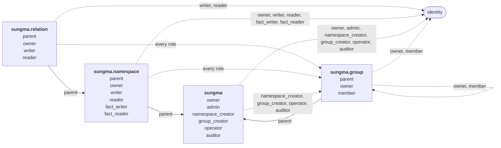

# Sungma's own authorization

Sungma authorizes the callers of its own services with its own model. Who may create a [[namespace]], edit one, or write and read the [[fact]]s under a [[relation]] is itself a set of facts, checked like any other. Author, Sungma's UI, shows each person only what those facts allow.

Every authorization rule is a check against the model. Each endpoint runs one fixed check, and the model decides who passes it. No code names a role or a protected fact.

## Subjects

A role is held by a [[subject]]: a person's or client's [[identity]], or a group's members. The caller of a request is its token's `sub` claim, an identity, as [[check-takes-a-caller-token-and-a-subject-token]] decides. For Check, that is the caller token's `sub`, not the subject the check is about. Sungma doesn't tell people and clients apart.

## Two tiers

The model separates two kinds of work:

- **Writing namespaces** is specialist work. A namespace's [[rewrite]]s decide who can reach what, so whoever edits one needs to understand the security it encodes.
- **Writing facts** is everyday work, such as sharing an invoice. Most people only ever write facts, and usually under a few relations.

Neither implies the other. A namespace's writer can't write its facts unless they're also granted that, and a fact writer can't write the namespace.

## The model

```toml
# The deployment: its owners and admins, operators and auditors, and who may create namespaces and groups
[sungma]
owner = { subjects = ["identity"], written_by = "sungma" }
admin = { rewrite = "this | owner", subjects = ["identity"], written_by = "owner" }
namespace_creator = { rewrite = "this | admin", subjects = ["identity", "sungma.group#member"], written_by = "admin" }
group_creator = { rewrite = "this | admin", subjects = ["identity", "sungma.group#member"], written_by = "admin" }
operator = { rewrite = "this | admin", subjects = ["identity", "sungma.group#member"], written_by = "admin" }
auditor = { rewrite = "this | admin", subjects = ["identity", "sungma.group#member"], written_by = "admin" }

# Each namespace: who owns it, who writes its document, and who works with all its facts
["sungma.namespace"]
parent = { subjects = ["sungma"], written_by = "sungma" }
owner = { rewrite = "this | (parent, admin)", subjects = ["identity", "sungma.group#member"], written_by = "owner" }
writer = { rewrite = "this | owner", subjects = ["identity", "sungma.group#member"], written_by = "owner" }
reader = { rewrite = "this | writer | fact_reader | (parent, auditor)", subjects = ["identity", "sungma.group#member"], written_by = "owner" }
fact_writer = { rewrite = "this | owner", subjects = ["identity", "sungma.group#member"], written_by = "owner" }
fact_reader = { rewrite = "this | fact_writer | (parent, auditor)", subjects = ["identity", "sungma.group#member"], written_by = "owner" }

# Each relation: who owns it through its namespace, and who writes and reads the facts under it
["sungma.relation"]
parent = { subjects = ["sungma.namespace"], written_by = "sungma" }
owner = "(parent, owner)"
writer = { rewrite = "this | (parent, fact_writer)", subjects = ["identity", "sungma.group#member"], written_by = "owner" }
reader = { rewrite = "this | writer | (parent, fact_reader)", subjects = ["identity", "sungma.group#member"], written_by = "owner" }

# Each group: who owns it and who is in it
["sungma.group"]
parent = { subjects = ["sungma"], written_by = "sungma" }
owner = { rewrite = "this | (parent, admin)", subjects = ["identity", "sungma.group#member"], written_by = "owner" }
member = { subjects = ["identity", "sungma.group#member"], written_by = "owner" }
```

Drawn as a graph, each namespace is a node, and each relation's accepted subjects are its edges. Solid edges are the `parent` links that rewrites follow. Dashed edges go to identities, the keys of the people and clients who hold roles, and to groups, which hold roles for their members.



`sungma.relation`'s `owner` accepts no facts. It reads the owners of the relation's namespace through `parent`.

Facts name four kinds of [[resource]]:

- `sungma:deployment`, the one deployment. Setup's first fact names it.
- `sungma.namespace:<name>`, one for each namespace, such as `sungma.namespace:billing`.
- `sungma.relation:<namespace>/<relation>`, one for each relation, such as `sungma.relation:billing/approver`. A relation name holds no `/`, so the id reads one way.
- `sungma.group:<name>`, one for each group, such as `sungma.group:billing-ops`.

Three kinds of fact link these resources, all under `parent`:

- `sungma.namespace:billing#parent@sungma:deployment#...` makes every admin an owner of `billing`.
- `sungma.relation:billing/approver#parent@sungma.namespace:billing#...` lets `billing`'s owners, fact writers and fact readers reach its `approver` facts.
- `sungma.group:billing-ops#parent@sungma:deployment#...` makes every admin an owner of `billing-ops`.

## Who writes each relation

A relation may declare which relation on the same resource may write its facts, as `written_by = "<relation>"`. [Namespace documents](namespace-documents.md#accepted-subjects) gives its form.

Writing a fact `N:r#R@s`, either adding it or retiring it, checks `N:r#W` for the caller, where `W` is `R`'s `written_by`. The check stays on the fact's own resource. A grant on `sungma.namespace:billing#reader` checks `sungma.namespace:billing#owner`, so an owner of `billing` grants `reader` on `billing` and on no other namespace.

A relation that declares no `written_by` is written by whoever holds `sungma.relation:N/R#writer`. That is how most relations in a customer's namespace are written. Every relation in Sungma's own namespaces that accepts facts declares `written_by`, so none of them falls back to a resource shared by every namespace.

`written_by = "sungma"` means no caller writes the relation through the API. Only Sungma's own tooling writes it: deployment setup, run out of band with the deployment's credentials, and Sungma releases. Setup is also the break-glass path, for example to replace a lost or untrustworthy deployment owner.

A namespace's `written_by` options are part of the security it encodes, so declaring them is the namespace writer's work.

Each protection in the model rests on one of these declarations:

- `sungma:deployment#owner` is `written_by = "sungma"`. No caller grants or revokes `owner`, an owner included, so no one takes the deployment over through the API, and no one locks its owners out.
- `sungma:deployment#admin` is `written_by = "owner"`. Admins run everything else but can't grant or revoke `admin`, so no admin can remove another.
- `parent` in `sungma.namespace`, `sungma.relation` and `sungma.group` is `written_by = "sungma"`. Sungma writes those facts itself, as [Creating a namespace](#creating-a-namespace), [New relations](#new-relations) and [Groups](#groups) say. A caller who could add one could tie a namespace to a resource they control. A caller who could retire one could cut a namespace, relation or group off from the admins and auditors who reach it through `parent`.
- A group's `member` is `written_by = "owner"`, so a member can't leave a group on their own.

## Policies

Each endpoint has a policy, a fixed check it runs. An endpoint's policy is fixed, and the model decides who passes it. So adding a role, or changing who may write a relation, is a model change, never a code change. No code holds a list of protected facts or roles.

| Endpoint | Policy (the check it runs) |
|---|---|
| Write facts: each fact under `N:r#R`, added or retired, where `R` declares `written_by = "W"` | `N:r#W` for the caller |
| Write facts: each fact under `N:r#R`, where `R` declares no `written_by` | `sungma.relation:N/R#writer` for the caller |
| Write facts: each fact under a relation with `written_by = "sungma"` | refused for every caller |
| Write a new version of namespace `N` | `sungma.namespace:N#writer` |
| Retire namespace `N` | `sungma.namespace:N#owner` |
| Create namespace `N` | `sungma:deployment#namespace_creator` |
| Create group `G` | `sungma:deployment#group_creator` |
| Change a deployment setting | `sungma:deployment#admin` |
| Read facts under `N:r#R`, or check a [[subjectset]] formed from it, where `R` declares `written_by = "W"` | `N:r#W` or `sungma:deployment#auditor` |
| Read facts under `N:r#R`, or check a subjectset formed from it, where `R` declares no `written_by` | `sungma.relation:N/R#reader` |
| Read facts under a relation with `written_by = "sungma"`, or check a subjectset formed from it | `sungma:deployment#auditor` |
| Read a namespace's document | `sungma.namespace:N#reader` |
| Read logs and metrics | `sungma:deployment#operator` |
| Read and replay the audit records of decisions | `sungma:deployment#auditor` |

The fact-write endpoint applies its policy to each fact in a batch, and refuses the batch if any fact fails.

Reading follows writing. Whoever may write a grant may read it, so a namespace's owners read the grants on it and its relations, and a group's owners read its members and owners. Auditors read every grant too. No `read_by` option is needed.

A fact's subject may name a resource or subjectset in another namespace. Writing the fact checks only its own relation's policy, nothing on the namespace it points into.

## What follows from the model

This summary follows from the model and the policies. It isn't a separate rule.

- The deployment's owners decide the admins. Every owner is an admin.
- Admins grant `namespace_creator`, `group_creator`, `operator` and `auditor`, and own every namespace and group through `parent`.
- A namespace's owners grant every role on the namespace and its relations, write new versions and retire it.
- A namespace-wide grant flows down: `fact_writer` on `billing` makes its holder a `writer` on every relation in `billing`, including relations added later.
- A group's owners change its members and its owners.
- An auditor reads every namespace's document and every fact, and changes nothing.

## Protected namespaces

No caller changes the `sungma`, `sungma.namespace`, `sungma.relation` and `sungma.group` namespaces themselves. Only a Sungma release changes them, since an edit could lock everyone out. The model enforces this. Writing a version of `sungma.group` checks `sungma.namespace:sungma.group#writer`, and that resource has no `parent` fact and no `owner` fact. No caller can add one, because `parent` is `written_by = "sungma"` and `owner` is `written_by = "owner"`, which nobody holds there.

That holds only while no namespace other than Sungma's own has `sungma` as its first segment, as [Namespace documents](namespace-documents.md#names) reserves. Creating one is refused, so a namespace such as `sungma.audit` can't pass for one of Sungma's own.

## The deployment's owners

A role is trust placed in the people who hold it. The deployment's owners are the people the organization trusts most: they decide who the admins are. Every owner is an admin too.

`owner` is `written_by = "sungma"`, so only deployment setup writes `owner` facts, run out of band by whoever controls the deployment's configuration. Setup names each owner by identity, the `sub` the identity provider issues to them, and each run is recorded for auditors. The first owners can act as soon as they first sign in to Author, and nobody becomes an owner by signing in first. Owners are admins, and nothing in the API removes them, so the deployment always has an admin.

A deployment has at least two owners. Setup refuses to leave fewer, so losing one owner's identity never leaves the deployment without one. Setup is also how the organization recovers from a lost or untrustworthy owner: it runs setup again with the owners it trusts. That doesn't guard against owners who abuse their trust. Nothing in the model can. Choosing them well is the organization's part.

## Authorizing a write

A write is authorized at the [head](table.md#the-head) it's based on, in its own [unit of work](table.md#the-table-and-the-contexts). Every write commits only while the head is unchanged, so a write that retries is authorized again at the new head. A role revoked by a write that committed first can't authorize a write that commits after it.

A read is authorized at the snapshot it reads, so a role revoked before that snapshot can't read data written after it.

## Creating a namespace

Creating a namespace stores it, the fact tying it to the deployment, an `owner` fact for its creator, and a `parent` fact for each of its relations, in one unit of work. Either all of them are stored or none is, so a namespace never exists without an owner.

## Groups

A group holds a role for its members. One fact, such as `sungma.namespace:billing#reader@sungma.group:billing-ops#member`, makes every member of `billing-ops` a reader of `billing`. A group's members can include other groups, so membership nests, within the limits [Checks on the data](#checks-on-the-data) sets.

Creating a group stores its `parent` fact and an `owner` fact for its creator in one unit of work, as creating a namespace does. Admins own every group through `parent`.

## New relations

A namespace version that declares a relation the namespace's earlier versions didn't stores the relation's `parent` fact in the same unit of work. A relation a later version drops keeps its `parent` fact and the grants on it. Nothing reads them while the relation is gone. A version that declares the relation again writes its `parent` fact afresh, opening a new span, so the relation keeps its link whatever rule [open question 6](#open) settles for grants.

## Checks on the data

Some rules aren't about who may write, but about the shape of the data. Write checks them separately from authorization, for every caller:

- Adding a fact under `sungma.relation:<namespace>/<relation>` is refused unless the namespace's latest version declares that relation. Otherwise a grant on a relation that doesn't exist yet would lie hidden, then take effect the day a version declares it. Retiring one is always allowed, so a grant on a dropped relation can still be revoked before the relation returns.
- Adding a fact whose subject is `sungma.group:<name>#member` is refused unless that group has been created. Otherwise a grant to a group that doesn't exist yet would take effect the day someone creates it.
- A namespace name whose first segment is `sungma` is refused, as [Protected namespaces](#protected-namespaces) says.
- Nesting is bounded, so a check that reaches a group never has to walk an unbounded graph.

The nesting limits are options on the `member` relation, declared in the model and generic to any relation. Write refuses a fact that makes a group a member of another group when:

- it would form a cycle, because the containing group is already reachable from the one being added;
- the longest chain of nested groups through it would be deeper than the depth limit;
- the containing group would hold more groups as direct members than the width limit. Identities don't count toward it, so a group imported from an identity provider can hold any number of people.

The two limits are deployment settings. They default to 10 levels deep and 32 groups wide. Write checks them at the head the write is based on, and checks them again when the write retries, so two writes can't each add half of a cycle.

## Conditions

Some rules need the request's context, which the model doesn't hold. Privileged writes need a recent sign-in, as [[privileged-roles-need-a-recent-sign-in]] says, and that needs the caller token's `auth_time`. Conditions on the roadmap enforce it: a privileged relation's condition requires a recent `auth_time`. Until conditions exist, how Sungma enforces it is [open](#open).

## Required tests

1. Each endpoint's policy allows a caller who passes its check, and refuses a caller who doesn't.
2. `fact_writer` on a namespace allows writing facts under every relation in it, including one a later version adds.
3. A namespace writer who isn't a fact writer can't write facts, and a fact writer who isn't a namespace writer can't write a namespace version.
4. Admins own every namespace without an `owner` fact of their own.
5. A person and a client with the same roles get the same answers.
6. A version of `sungma`, `sungma.namespace`, `sungma.relation` or `sungma.group` is refused for every caller, an admin included, because their `sungma.namespace` resources have no `parent` or `owner` fact.
7. An admin who isn't an owner can't grant or revoke `admin`, because `admin` is `written_by = "owner"`.
8. A fact under `sungma:deployment#owner` is refused for every caller, an admin and an owner included, because `owner` is `written_by = "sungma"`.
9. A failed namespace creation stores none of its items.
10. A new relation gets its `parent` fact in the same unit of work as the version that declares it.
11. An auditor reads every namespace's document, the facts under every relation and the grants under Sungma's own namespaces, and every write by an auditor who holds no other role is refused.
12. A role granted to a group reaches its members, including members of groups nested inside it, and a group's owner can change its members without holding any other role.
13. A write that retries is authorized again at the new head.
14. A failed group creation stores neither fact, and an admin owns every group without an `owner` fact.
15. A fact whose subject names another namespace needs only its own relation's policy.
16. A group's members can't be made admins through the group, because `admin` accepts identities only.
17. Adding or retiring a `parent` fact in `sungma.namespace`, `sungma.relation` or `sungma.group` is refused from every caller, an admin included, because `parent` is `written_by = "sungma"`.
18. A grant on `sungma.relation:<namespace>/<relation>` is refused while the namespace doesn't declare the relation.
19. Creating a namespace whose first segment is `sungma` is refused.
20. Making a group a member of a group that it already contains, directly or through nesting, is refused, and so is a group made a member of itself.
21. Nesting groups one level deeper than the depth limit, or giving a group one more nested group than the width limit, is refused, and the limits come from the deployment's settings.
22. Two writes that would together form a cycle can't both commit.
23. Revoking a grant on a dropped relation is allowed, and a grant on a relation the namespace doesn't declare can't be added.
24. A relation declared again has a `parent` fact whose span opens at the new version.
25. A grant to a group that hasn't been created is refused.
26. An owner reads the grants on their namespace and its relations, and the members and owners of their group, and a caller without `owner` can't.
27. A member removing themselves from a group is refused unless they own it, because `member` is `written_by = "owner"`.
28. Changing a deployment setting needs `admin`.
29. A read at a snapshot taken after a role was revoked is refused for the caller who lost it.
30. Setup refuses to leave the deployment with fewer than two owners.
31. An owner of one namespace can grant `reader` on it, and can't grant `reader` on another namespace.
32. A grant on `sungma.relation:billing/approver#writer` checks `billing`'s owners: an owner of `billing` may add or retire it, and an owner of another namespace can't.
33. A `group_creator` who isn't an admin can create a group and owns it.
34. In a customer's namespace, a fact under a relation that declares `written_by` checks that relation on the fact's resource, and a fact under a relation that declares none checks `sungma.relation:N/R#writer`.
35. A batch of facts in which one fact fails its policy is refused whole.

## Open

1. How deployment setup runs, where it takes the owners' identities from, and how its runs are recorded for auditors.
2. What `operator` covers beyond logs and metrics, such as health, and whether operators may read namespace documents to diagnose a problem.
3. Whether a namespace's owner should be able to transfer ownership, or revoke the last owner while admins still own it through the deployment.
4. How groups imported through SCIM are named, created and edited. See [[scim-imports-users-and-groups]].
5. How a namespace version that adds more relations than one unit of work holds gets its `parent` facts, and how namespace writes and the table make room for fact items in a namespace write. [Table](table.md#open) holds the general question of writes larger than one unit of work.
6. Whether grants start fresh when a relation comes back, or a retired namespace is created again. A relation brought back gets a new epoch, so its facts from before don't count. The grants on it, such as `sungma.relation:billing/approver#writer@alice`, sit under `sungma.relation`'s `writer`, which is never dropped, so they count again. A grant could count only if it was written after its relation's current epoch, the same rule its facts follow.
7. Who may create a retired namespace again. As written, anyone with `namespace_creator` can recreate a retired name and become its owner. Facts under the old namespace stay dead, since every relation gets a new epoch. But facts in other namespaces that point into it, such as `file:secret#viewer@billing:acct-42#member`, live under their own namespace and still count, and the new owner now decides who is in `billing:acct-42#member`. Reusing a retired name stays possible, since that's what namespace versions are for. The options are about who may do it:
   - Recreating a retired name needs `owner` on it. The old owners' grants survive retirement, because they live in `sungma.namespace`, and admins reach it through `parent`.
   - Only admins may recreate a retired name, and they grant ownership afresh. This pairs with old grants ending at the new epoch, as question 6 proposes.
   - A proposed answer: a fact whose subject is in another namespace records that subject's epoch when it's written. That's the epoch of the subject's relation, such as `billing`'s `member`, or for a resource member such as `folder:root#...`, the epoch the subject's namespace was last created at. The fact counts only while both its own relation's epoch and its recorded subject epoch still hold. Recreating `billing` gives `member` a new epoch, so `file:secret#viewer@billing:acct-42#member` stops counting without being touched, and a recreated namespace inherits nothing that pointed into it. A namespace recreated under its old name is the same namespace, started fresh. Reads at earlier revisions still show its old versions, relations and facts. A fact pointing into it that is wanted again is written again, and records the new epoch. This changes [One timeline](one-timeline.md), which says when a fact counts, and [Table](table.md), which says what a span stores.
8. How a relation's options declare the nesting limits, no cycles and bounded depth and width, so they're declared on `member` in the model and apply to any relation that declares them.
9. Whether the other checks on the data, a grant only on a declared relation and a grant only to a created group, become relation options too, so no check on the data names one of Sungma's namespaces.
10. How privileged writes need a recent sign-in until conditions exist. Once they do, a privileged relation's condition requires a recent `auth_time`, as [Conditions](#conditions) says.
