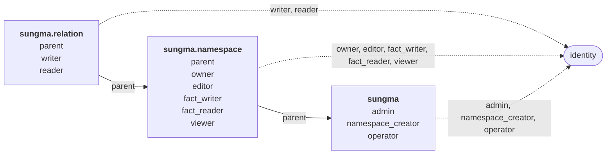

# Sungma's own authorization

Sungma authorizes the callers of its own services with its own model. Who may create a [[namespace]], edit one, or write and read the [[fact]]s under a [[relation]] is itself a set of facts, checked like any other. Author, Sungma's UI, shows each person only what those facts allow.

## Subjects

A role is held by a [[subject]], and a subject is a person or a client alike. The subject of a request is its token's `sub` claim, an [[identity]], as [[check-takes-a-caller-token-and-a-subject-token]] decides. Sungma doesn't tell people and clients apart.

## Two tiers

The model separates two kinds of work:

- **Writing namespaces** is operator work. A namespace's rewrites decide who can reach what, so whoever edits one needs to understand the security it encodes.
- **Writing facts** is everyday work, such as sharing an invoice. Most people only ever write facts, and usually under a few relations.

Neither implies the other. An editor of a namespace can't write its facts unless they're also granted that, and a fact writer can't edit the namespace.

## The model

```toml
# The deployment: its admins, its operators, and who may create namespaces
[sungma]
admin = { subjects = ["identity"] }
namespace_creator = { rewrite = "this | admin", subjects = ["identity"] }
operator = { rewrite = "this | admin", subjects = ["identity"] }

# Each namespace: who owns it, who edits its rewrites, and who works with all its facts
["sungma.namespace"]
parent = { subjects = ["sungma"] }
owner = { rewrite = "this | (parent, admin)", subjects = ["identity"] }
editor = { rewrite = "this | owner", subjects = ["identity"] }
fact_writer = { rewrite = "this | owner", subjects = ["identity"] }
fact_reader = { rewrite = "this | fact_writer", subjects = ["identity"] }
viewer = { rewrite = "this | editor | fact_reader", subjects = ["identity"] }

# Each relation: who writes and reads the facts under it
["sungma.relation"]
parent = { subjects = ["sungma.namespace"] }
writer = { rewrite = "this | (parent, fact_writer)", subjects = ["identity"] }
reader = { rewrite = "this | writer | (parent, fact_reader)", subjects = ["identity"] }
```

Drawn as a graph, each namespace is a node, and each relation's accepted subjects are its edges. Solid edges are the `parent` links that rewrites follow. Dashed edges go to identities, the people and clients who hold roles.



The [[resource]]s are:

- `sungma:deployment`, the one deployment.
- `sungma.namespace:<name>`, one for each namespace, such as `sungma.namespace:billing`.
- `sungma.relation:<namespace>/<relation>`, one for each relation, such as `sungma.relation:billing/viewer`. A relation name holds no `/`, so the id reads one way.

Two kinds of fact link these resources, and only Sungma writes them:

- `sungma.namespace:billing#parent@sungma:deployment#...` makes every admin an owner of `billing`.
- `sungma.relation:billing/viewer#parent@sungma.namespace:billing#...` lets `billing`'s fact writers and fact readers reach its `viewer` facts.

## What each role allows

| To do this | the subject needs |
|---|---|
| Grant or revoke `admin`, `namespace_creator` or `operator` | `admin` on `sungma:deployment` |
| Create a namespace | `namespace_creator` on `sungma:deployment` |
| Run the deployment: read its logs and metrics | `operator` on `sungma:deployment` |
| Write a new version of a namespace, or retire it | `editor` on the namespace |
| See a namespace's document | `viewer` on the namespace |
| Grant or revoke a role on a namespace or one of its relations | `owner` on the namespace |
| Write facts under a relation | `writer` on the relation |
| Read facts under a relation, or check a [[subjectset]] formed from it | `reader` on the relation |

A fact's subject may name a resource or subjectset in another namespace. Writing the fact needs `writer` on its own relation only, nothing on the namespace it points into.

A namespace-wide grant flows down: `fact_writer` on `billing` makes its holder a `writer` on every relation in `billing`, including relations added later.

## Protected namespaces

Write refuses any change to the `sungma`, `sungma.namespace` and `sungma.relation` namespaces themselves. Only a Sungma release changes them, since an edit could lock everyone out.

Write also refuses a fact under `parent` from any caller. Sungma writes those facts itself, as [Creating a namespace](#creating-a-namespace) and [New relations](#new-relations) say. A caller who could write one could tie a namespace to a resource they control.

## The first admin

Deployment setup names one subject and writes `sungma:deployment#admin@<subject>`. The identity provider is seeded with a user under that same id, so the first person to sign in to Author is already an admin. Nobody becomes admin by signing in first.

## The last admin

Revoking `admin` from the last subject that holds it is refused. The revocation reads the admins at the head it's based on, in its own unit of work. Every write commits only while the head is unchanged. When two admins revoke each other at once, one commits, and the other retries, finds one admin left, and is refused.

## Creating a namespace

Creating a namespace stores it, the fact tying it to the deployment, and an `owner` fact for its creator, in one unit of work. Either all three are stored or none is, so a namespace never exists without an owner.

## New relations

A namespace version that declares a relation the namespace's earlier versions didn't stores the relation's `parent` fact in the same unit of work. A relation a later version drops keeps its fact. The fact is then inert, like any fact under a dropped relation.

## Required tests

1. Each role in [What each role allows](#what-each-role-allows) allows its operation, and a subject without it is refused.
2. `fact_writer` on a namespace allows writing facts under every relation in it, including one a later version adds.
3. An editor who isn't a fact writer can't write facts, and a fact writer who isn't an editor can't write a namespace version.
4. Admins own every namespace without an `owner` fact of their own.
5. A person and a client with the same roles get the same answers.
6. Writes that change `sungma`, `sungma.namespace` or `sungma.relation`, and facts under `parent` from a caller, are refused.
7. Two admins revoking each other at once leave one admin.
8. A failed namespace creation stores none of its three items.
9. A new relation gets its `parent` fact in the same unit of work as the version that declares it.

## Open

1. How deployment setup runs, and where it takes the first admin's subject from.
2. What `operator` covers beyond logs and metrics: audit records, replaying decisions, health, and whether operators may see namespace documents to diagnose a problem.
3. Whether a namespace's owner should be able to transfer ownership, or revoke the last owner while admins still own it through the deployment.
