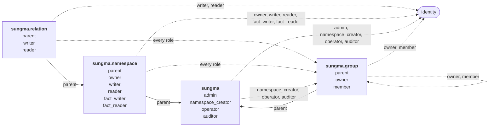

# Sungma's own authorization

Sungma authorizes the callers of its own services with its own model. Who may create a [[namespace]], edit one, or write and read the [[fact]]s under a [[relation]] is itself a set of facts, checked like any other. Author, Sungma's UI, shows each person only what those facts allow.

## Subjects

A role is held by a [[subject]]: a person's or client's [[identity]], or a group's members. The caller of a request is its token's `sub` claim, an identity, as [[check-takes-a-caller-token-and-a-subject-token]] decides. For Check, that is the caller token's `sub`, not the subject the check is about. Sungma doesn't tell people and clients apart.

## Two tiers

The model separates two kinds of work:

- **Writing namespaces** is specialist work. A namespace's [[rewrite]]s decide who can reach what, so whoever edits one needs to understand the security it encodes.
- **Writing facts** is everyday work, such as sharing an invoice. Most people only ever write facts, and usually under a few relations.

Neither implies the other. A namespace's writer can't write its facts unless they're also granted that, and a fact writer can't write the namespace.

## The model

```toml
# The deployment: its admins, operators and auditors, and who may create namespaces
[sungma]
admin = { subjects = ["identity"] }
namespace_creator = { rewrite = "this | admin", subjects = ["identity", "sungma.group#member"] }
operator = { rewrite = "this | admin", subjects = ["identity", "sungma.group#member"] }
auditor = { rewrite = "this | admin", subjects = ["identity", "sungma.group#member"] }

# Each namespace: who owns it, who writes its document, and who works with all its facts
["sungma.namespace"]
parent = { subjects = ["sungma"] }
owner = { rewrite = "this | (parent, admin)", subjects = ["identity", "sungma.group#member"] }
writer = { rewrite = "this | owner", subjects = ["identity", "sungma.group#member"] }
reader = { rewrite = "this | writer | fact_reader | (parent, auditor)", subjects = ["identity", "sungma.group#member"] }
fact_writer = { rewrite = "this | owner", subjects = ["identity", "sungma.group#member"] }
fact_reader = { rewrite = "this | fact_writer | (parent, auditor)", subjects = ["identity", "sungma.group#member"] }

# Each relation: who writes and reads the facts under it
["sungma.relation"]
parent = { subjects = ["sungma.namespace"] }
writer = { rewrite = "this | (parent, fact_writer)", subjects = ["identity", "sungma.group#member"] }
reader = { rewrite = "this | writer | (parent, fact_reader)", subjects = ["identity", "sungma.group#member"] }

# Each group: who owns it and who is in it
["sungma.group"]
parent = { subjects = ["sungma"] }
owner = { rewrite = "this | (parent, admin)", subjects = ["identity", "sungma.group#member"] }
member = { subjects = ["identity", "sungma.group#member"] }
```

Drawn as a graph, each namespace is a node, and each relation's accepted subjects are its edges. Solid edges are the `parent` links that rewrites follow. Dashed edges go to identities, the keys of the people and clients who hold roles, and to groups, which hold roles for their members.



Facts name four kinds of [[resource]]:

- `sungma:deployment`, the one deployment. Setup's first fact names it.
- `sungma.namespace:<name>`, one for each namespace, such as `sungma.namespace:billing`.
- `sungma.relation:<namespace>/<relation>`, one for each relation, such as `sungma.relation:billing/approver`. A relation name holds no `/`, so the id reads one way.
- `sungma.group:<name>`, one for each group, such as `sungma.group:billing-ops`.

Three kinds of fact link these resources, and only Sungma writes them:

- `sungma.namespace:billing#parent@sungma:deployment#...` makes every admin an owner of `billing`.
- `sungma.relation:billing/approver#parent@sungma.namespace:billing#...` lets `billing`'s fact writers and fact readers reach its `approver` facts.
- `sungma.group:billing-ops#parent@sungma:deployment#...` makes every admin an owner of `billing-ops`.

## What each role allows

| To do this | the caller needs |
|---|---|
| Grant or revoke `admin`, `namespace_creator`, `operator` or `auditor` | `admin` on `sungma:deployment` |
| Create a namespace | `namespace_creator` on `sungma:deployment` |
| Create a group | `admin` on `sungma:deployment` |
| Add or remove a group's members, or grant or revoke its `owner` | `owner` on the group |
| Run the deployment: read its logs and metrics | `operator` on `sungma:deployment` |
| Read and replay the audit records of decisions | `auditor` on `sungma:deployment` |
| Write a new version of a namespace, or retire it | `writer` on the namespace |
| Read a namespace's document | `reader` on the namespace |
| Grant or revoke a role on a namespace or one of its relations | `owner` on the namespace |
| Write facts under a relation | `writer` on the relation |
| Read facts under a relation, or check a [[subjectset]] formed from it | `reader` on the relation |

Facts under `sungma`, `sungma.namespace`, `sungma.relation` and `sungma.group` follow the rows that name them, and an auditor reads them all. The `writer` and `reader` rows cover facts under every other namespace.

A fact's subject may name a resource or subjectset in another namespace. Writing the fact needs `writer` on its own relation only, nothing on the namespace it points into.

An auditor reads every namespace's document and every fact, and changes nothing.

A namespace-wide grant flows down: `fact_writer` on `billing` makes its holder a `writer` on every relation in `billing`, including relations added later.

## Protected namespaces

Write refuses any change to the `sungma`, `sungma.namespace`, `sungma.relation` and `sungma.group` namespaces themselves. Only a Sungma release changes them, since an edit could lock everyone out.

Write also refuses a fact under `parent` in `sungma.namespace`, `sungma.relation` or `sungma.group` from any caller. Sungma writes those facts itself, as [Creating a namespace](#creating-a-namespace), [New relations](#new-relations) and [Groups](#groups) say. A caller who could write one could tie a namespace to a resource they control.

## The first admin

Deployment setup names one identity, the `sub` the identity provider issues to the first admin, and writes `sungma:deployment#admin@<sub>`. That person is admin when they first sign in to Author. Nobody becomes admin by signing in first.

## Authorizing a write

A write is authorized at the [head](table.md#the-head) it's based on, in its own [unit of work](table.md#the-table-and-the-contexts). Every write commits only while the head is unchanged, so a write that retries is authorized again at the new head. A role revoked by a write that committed first can't authorize a write that commits after it.

## Revoking your own role

No caller may revoke a privileged role from themselves: `admin`, or `owner` of a namespace or a group. Stepping down from one means asking another holder. Everyday roles, such as a group membership, can be given up freely.

`admin` is granted to identities only, never to a group, and only an admin can revoke `admin`. A caller who revokes `admin` therefore remains an admin after the write, so the deployment always has at least one.

When two admins revoke each other at once, one write commits. The other retries, is authorized again at the new head, finds its caller no longer holds `admin`, and is refused. One admin is left either way.

## Creating a namespace

Creating a namespace stores it, the fact tying it to the deployment, an `owner` fact for its creator, and a `parent` fact for each of its relations, in one unit of work. Either all of them are stored or none is, so a namespace never exists without an owner.

## Groups

A group holds a role for its members. One fact, such as `sungma.namespace:billing#reader@sungma.group:billing-ops#member`, makes every member of `billing-ops` a reader of `billing`. A group's members can include other groups, so membership nests.

Creating a group stores its `parent` fact and an `owner` fact for its creator in one unit of work, as creating a namespace does. Admins own every group through `parent`.

## New relations

A namespace version that declares a relation the namespace's earlier versions didn't stores the relation's `parent` fact in the same unit of work. A relation a later version drops keeps its `parent` fact and the grants on it. Nothing reads them while the relation is gone, and they count again if a later version brings the relation back.

## Required tests

1. Each role in [What each role allows](#what-each-role-allows) allows its operation, and a caller without it is refused.
2. `fact_writer` on a namespace allows writing facts under every relation in it, including one a later version adds.
3. A namespace writer who isn't a fact writer can't write facts, and a fact writer who isn't a namespace writer can't write a namespace version.
4. Admins own every namespace without an `owner` fact of their own.
5. A person and a client with the same roles get the same answers.
6. Writes that change `sungma`, `sungma.namespace`, `sungma.relation` or `sungma.group` are refused, and so are facts under `parent` in `sungma.namespace`, `sungma.relation` or `sungma.group` from any caller.
7. Two admins revoking each other at once leave one admin: the write that commits second is authorized again and refused.
8. A failed namespace creation stores none of its items.
9. A new relation gets its `parent` fact in the same unit of work as the version that declares it.
10. An auditor reads every namespace's document and the facts under every relation, and every write by an auditor who holds no other role is refused.
11. A role granted to a group reaches its members, including members of groups nested inside it, and a group's owner can change its members without holding any other role.
12. A caller revoking their own `admin`, or their own `owner` of a namespace or group, is refused, including inside a batch that also revokes others. A write that retries is authorized again at the new head.
13. A failed group creation stores neither fact, and an admin owns every group without an `owner` fact.
14. A fact whose subject names another namespace needs `writer` on its own relation only.
15. A group's members can't be made admins through the group, because `admin` accepts identities only.

## Open

1. How deployment setup runs, and where it takes the first admin's `sub` from.
2. What `operator` covers beyond logs and metrics, such as health, and whether operators may read namespace documents to diagnose a problem.
3. Whether a namespace's owner should be able to transfer ownership, or revoke the last owner while admins still own it through the deployment.
4. How groups imported through SCIM are named, created and edited. See [[scim-imports-users-and-groups]].
5. How a namespace version that adds more relations than one unit of work holds gets its `parent` facts, and how namespace writes and the table make room for fact items in a namespace write. [Table](table.md#open) holds the general question of writes larger than one unit of work.
6. Whether grants start fresh when a relation comes back, or a retired namespace is created again. A relation brought back gets a new epoch, so its facts from before don't count. The grants on it, such as `sungma.relation:billing/approver#writer@alice`, sit under `sungma.relation`'s `writer`, which is never dropped, so they count again. A grant could count only if it was written after its relation's current epoch, the same rule its facts follow.
